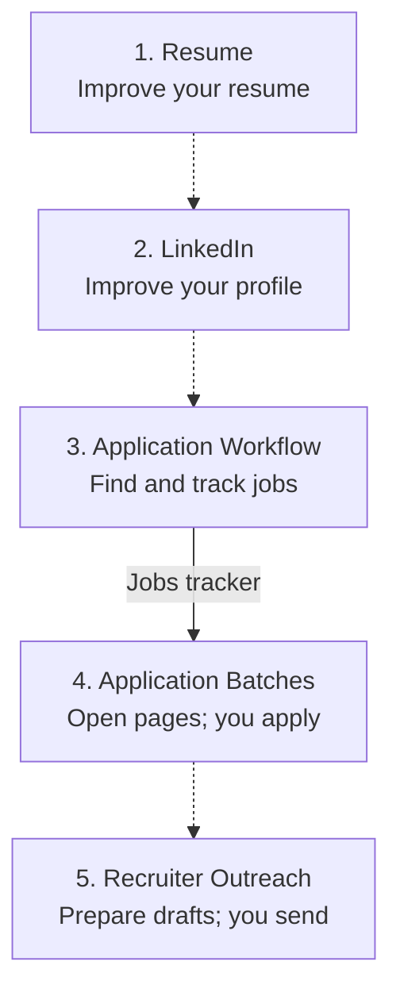

<h1>💼 job-search-ops</h1>

<strong>Your job search. One guided step at a time.</strong>

Improve your materials, find relevant jobs, and prepare applications and recruiter messages for your review.

  
  

<a href="ONBOARDING.md">Start setup</a> · <a href="#-choose-your-workflow">Choose a workflow</a> · <a href="#-follow-the-flow">See the flow</a>

---

## 📚 Choose your workflow

| Workflow | What you get | What you need to start |
| --- | --- | --- |
| [1. Resume](Resume/README.md) | Clearer experience bullets grounded in your work | Your resume and an AI assistant |
| [2. LinkedIn](LinkedIn/README.md) | A profile audit and reviewed improvements | Your resume and profile content; browser access for live changes |
| [3. Application Workflow](<Application Workflow/README.md>) | Job discovery, application/interview tracking and reports | Codex on macOS, Python and your selected tracker/sources |
| [4. Application Batches](<Application Batches/README.md>) | Eligible application pages opened for you | Completed Application Workflow setup, confirmed criteria and browser access |
| [5. Recruiter Outreach](<Recruiter Outreach/README.md>) | Screened contacts and unsent LinkedIn drafts | Independent Codex setup, browser access and a separate contact tracker |

## 🚀 Get started

1. **Resume or LinkedIn review:** open that folder's README and give your assistant the entire linked runbook. Supplied files are enough for a content review.
2. **Operational workflows:** download the complete repository or reviewed release ZIP, keep it in a permanent folder, and open it in Codex on macOS.
3. Follow [guided onboarding](ONBOARDING.md). Choose what you want; the agent explains and checks only the tools those choices need.

You do not need to edit JSON or install every tool. Personal settings, resumes, contacts and history stay in a separate private location.

## 🧭 Follow the flow

Dotted arrows show a suggested order; start with your current goal. **Batches requires completed Application Workflow setup and its pilot. Outreach works independently.**

For operational workflows, use the first-run request in your private setup summary. **Request Batches and Outreach separately:** discovery starts neither. Opening an application page does not mark it Applied. Only selected Application Workflow runs can be scheduled, after verification.

Each numbered workflow links to its setup, run instructions and preferences in the [table above](#-choose-your-workflow). Application Workflow's [guide catalog](<Application Workflow/docs/source-map.md>) explains its helpers, detailed procedures and support code.
